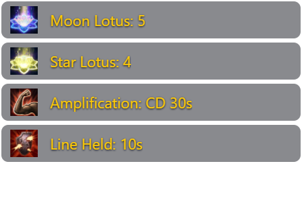
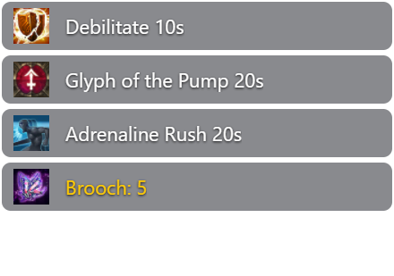
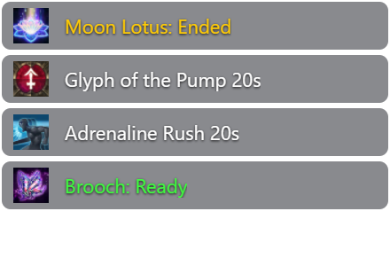

# Battle Notify

Buff, cooldown and combat notifications for TERA Toolbox. Based on Battle Notify by Caali / wuaw; extended by CEM.

## Installation

Download the installation ZIP from [Releases](https://github.com/Volframid/battle-notify-update/releases/latest) and extract the `battle-notify-update` folder. If using GitHub's source ZIP, rename the extracted folder to `battle-notify-update`. Place that folder in Toolbox's `mods` directory and restart Toolbox. Install only one copy. No additional mod or external skill data is required. Use graphical Toolbox on Windows 10/11.

## Automatic updates

Automatic updates are enabled. Toolbox checks this repository's `main` branch at startup and downloads changed code using the SHA-256 hashes in `manifest.json`. Restart Toolbox to load an update; updates are not applied during a fight. Updates follow the latest code on `main`; a new Release is not required.

The update includes the settings UI, icons, and both precompiled 32-bit/64-bit in-game renderers. Toolbox downloads and checks them automatically; there is no separate installer, compiler or paid overlay dependency. Fully exit TERA and restart Toolbox after updating so the linked game uses the new renderer.

Existing user configuration is kept: `config/`, `card-effects.json` and `lotus.json`. Missing default files are installed. Logs, character state and Toolbox's local settings are never downloaded or overwritten. New configuration defaults are available in the repository; existing settings are not reset.

Version 1.2 upgrades the recognized older notification rules in memory: named shared buffs, legacy Debilitate IDs and the Lancer countdown rules work without replacing personal configuration files. Custom labels and unrelated rules are preserved. The old offensive Debilitate reminder is replaced with `DEBILITATE missing`.

If upgrading from an older ZIP without an update address, install the current package once, or replace `module.json` and restart Toolbox. Also enable this mod's updates in Toolbox if a local `module.config.json` previously disabled them. Toolbox's global mod updates must be enabled.

For maintainers: every push to `main` runs the GitHub workflow to regenerate and commit the manifest. Wait for the workflow to succeed before announcing an update. Run `node scripts/build-manifest.cjs` before preparing an installation ZIP.

## Features

- Icon notifications for configured buffs, debuffs, skill/item cooldowns, resets and boss/party events.
- **Movable notification area:** drag and lock an independent overlay, with saved position, width, text/icon sizes, background opacity, duration and row limit.
- **Cards:** proc alerts, one cooldown warning at each 30-second milestone, then one live countdown throughout the final 30 seconds. Outside-combat summaries and configured Ready notifications are retained.
- **Brooch:** one live 5-to-1 countdown for the equipped brooch's recharge, including Shadow Rest, ending with Ready.
- **Lotus:** independent Moon/Star blessing countdowns from 5 to 1, ending with Ended in the same notification, with protection against false expiry alerts during map changes.
- **Lancer:** Debilitate and Line Held count down from 10 seconds. Refreshing above 10 seconds removes the countdown immediately; it returns on entering the final 10 seconds again. Legacy endurance debuffs (200300, 200301, 3012020) prevent false missing-Debilitate warnings.
- **Named shared buffs:** Infection, Adrenaline Rush, Edict of Judgment and Elemental: Thrall of Wrath display icon, name and remaining duration. Kaia's Shield and Elemental: Thrall of Protection display icon and name. Glyph of the Pump includes its name and duration; the final Antaroth message is `4! Dodge`.
- **One diagnostic log:** all notification components record through `battle log`.

The module displays notifications; it does not cast skills or use items.

## Notification examples

These are captures of the actual notification renderer with controlled sample events, not live combat screenshots. Timers update the same row; ordinary duration labels are snapshots. The background opacity remains adjustable; the notification frame and drag-preview outline are transparent.

## Commands

| Command | Action |
|---|---|
| `battle` | Show notification/logging status |
| `battle ui` | Open notification placement and appearance settings |
| `battle overlay move` / `battle overlay lock` | Unlock the preview for dragging / lock it |
| `battle overlay on` / `battle overlay off` | Use the movable area / return to native game alerts |
| `battle overlay test` | Display a test notification |
| `battle log` | Toggle recording |
| `battle log on` / `battle log off` | Start/stop recording explicitly |
| `battle log status` | Show recording status and filename |
| `battle mark description` | Add a test marker to the active recording |
| `cards` | Show observed card cooldowns |
| `cards reload` | Reload card settings; counters restart at the next proc |
| `cards clear` | Clear observed card counters |
| `battle lotus` | Show observed Lotus blessing/recharge times |
| `battle lotus reload` | Reload Lotus settings and synchronize existing buffs |

Logging starts OFF. Each recording creates one `logs/battle-*.jsonl` file containing state snapshots, relevant packets, notifications and tracking decisions. Use `battle log` before a test and again when finished. `cards log` and `battle lotus log` direct you to `battle log`. The separate Lotus Cycle mod owns the `lotus` command.

## Move your notifications

In game, type `/8 battle ui`. Choose **Move & preview**, drag the preview by its header, then select **Lock position**. Locked notifications pass mouse clicks through to the game and do not request keyboard focus. Closing settings also locks the preview. Use **Test notification** to check the result.

The settings window controls width, text and icon size, background opacity, display time and the maximum number of visible notifications. Sliders and numeric fields are both available. X/Y coordinates can also be entered directly. Changes save automatically in the private `data/overlay.json` file. Live countdowns remain until completion or cancellation; display time applies to ordinary alerts and the final Ended/Ready message. The row limit still applies, and updating a hidden timer does not move it ahead of newer notifications. A smaller display may show fewer rows to keep whole notifications visible; placement is kept within an available monitor after display changes. **Reset defaults** restores the initial placement and appearance.

The overlay is independent of Modern Meter and uses graphical Toolbox. Its in-game renderer supports Direct3D 9/11 in windowed, borderless and exclusive fullscreen modes. The same notification content and position settings are used across modes. Controlled graphics tests cover both client architectures; compatibility with a particular game build and other overlays still needs live verification. In exclusive fullscreen, opening the desktop settings panel can switch away from the game. Set appearance there, return to the game, then use `/8 battle overlay move` to drag the preview inside the game and click its **Lock position** header button. Turning off movable notifications restores the original game alerts. If the overlay is unavailable or still starting, alerts use the native route once, without replaying duplicates when the overlay becomes ready. Ordinary chat and notice channels retain their existing behavior. Notification timers follow observed buff and cooldown deadlines; they do not change gameplay or skill timing.

Game icons are bundled for the notification display, including the current Moon/Star Lotus and brooch variants. Unmapped server-specific icons use a neutral marker; notification text is retained. Native alerts continue to use the game's own icons. See [icon attribution](ui/ICONS.md).

## Settings

| File | Purpose |
|---|---|
| `config/common.js` | Shared notification rules |
| `config/<class>.js` | Skill and buff rules for all 13 classes |
| `config/common_styling.js` | Default channels and colors |
| `card-effects.json` | Card discovery, labels and cooldown warnings |
| `lotus.json` | Lotus IDs and expiry warnings |

Use existing event rules as templates. For messages, `{alert}` selects the screen notification, `{chat}` selects chat, and color tags such as `{yellow}` change the text color. `{icon}`, `{duration}`, `{stacks}` and `{name}` insert the available event information. Skill rules belong in the matching class file because skill IDs can overlap between classes.

**Card settings:** the countdown is fixed at the final 30 seconds, with earlier 30-second milestone alerts in or out of combat. Old `warningTimes` and `outOfCombat.milestoneTimes` fields no longer determine the cadence. `displayName` provides a short label. Automatic discovery covers the configured card effect ID range, not just the two included overrides. Cooldowns come from verified settings or client tooltip data; undocumented or unobserved cooldowns remain unknown. Ready means cooldown expiry, not a guaranteed proc. `notifyReady` and `outOfCombat.notifyReady` retain control of Ready: by default, the counter disappears at zero during combat and Ready is announced once outside combat.

**Lotus settings:** countdowns are fixed at the final 5 seconds; the older `warningTimes` field no longer determines the cadence. `notifyEnded` controls the final alert. Real speed blessings determine the timers, rather than cosmetic auras or short skill reuse. The supplied Moon/Star IDs match the observed server variant; adjust them for servers with different IDs.

Live countdowns require the movable notification renderer. If it is disabled or unavailable, native game alerts show the first counter value and the permitted final message only, avoiding a new native popup every second. Native game alerts cannot edit a previously displayed row.

Use the respective reload command after changing card/Lotus JSON settings. JavaScript changes require restarting Toolbox. Native game alerts keep the game-controlled placement; the movable area has its own settings described above.

## Sharing

Publish the source, configuration and this README. Exclude `logs/`, private `data/`, `LOCAL_UPDATES.md` and Toolbox's local `module.config.json`; `.gitignore` already covers them. The shared ZIP contains no personal logs or local control settings. Build it with `python scripts/package.py <output.zip>` after regenerating the manifest; packaging uses only the explicit manifest list. Native renderer source/build instructions and notices are in [native/README.md](native/README.md).
